# 4. Resultados y análisis de resultados

## 4.1 Características del conjunto de datos original

Los datos de esta fase son **subclips etiquetados** derivados de los videos anotados de la
competencia *DFL – Bundesliga Data Shootout*, publicados en Hugging Face como
`ManuD/dfl_clips`. Cada subclip es un archivo `.mp4` a 1920 × 1080 y 25 fps cuyo nombre
codifica el video, el milisegundo del evento y el del evento siguiente
(`<partido>_<tiempo>_<ms evento>_<ms siguiente>.mp4`). El conjunto tiene **762 subclips de
8 partidos** (Tabla 1).

*Tabla 1. Subclips por conjunto y clase.*

| Conjunto | Partidos | Fondo | Disputa | Pase | Saque de banda | Total |
|---|---|---|---|---|---|---|
| Entrenamiento | 7 | 100 | 100 | 100 | 100 | 400 |
| Prueba (`3c993bd2`) | 1 | 100 | 100 | 100 | 62 | 362 |

Antes de usarlos se verificó la calidad de las etiquetas: los 562 subclips con acción
coinciden con un evento del mismo tipo en `train.csv` a menos de 0.5 s (100 %). Los
subclips varían mucho de duración (de 0.3 s a 121.5 s; mediana de 160 cuadros) y esa
duración depende de la clase: los de fondo duran en promedio 11.0 s en entrenamiento y los
de acción entre 5.3 y 6.4 s. El contexto disponible antes del evento tiene una mediana de
5.3 s, pero el 13.9 % de los subclips tiene menos de 1.5 s.

## 4.2 Limpieza y preprocesamiento

El preprocesamiento es el mismo para el entrenamiento y para la aplicación
(`src/preprocessing.py` y `src/features.py`), de modo que un video nuevo pasa exactamente
por los mismos pasos:

1. **Recuperación del contexto.** Los subclips se cortaron sin recodificar y una *edit list*
   oculta los cuadros previos al evento; se lee el archivo ignorándola para recuperar
   hasta 10 s de contexto y se ubica el evento a partir de los milisegundos del nombre.
2. **Ventana fija.** De cada subclip se toma una ventana de 1.62 s (1.5 s antes del evento
   y 0.12 s después) muestreada en **16 cuadros equiespaciados** (~10 fps). Cuando falta
   contexto se repite el primer cuadro en lugar de desplazar la ventana, para que el evento
   caiga siempre en la misma posición.
3. **Recorte de superposiciones.** Se elimina el 10 % superior (marcador y marca de agua)
   y el 4 % inferior de cada cuadro, hallazgo del análisis exploratorio.
4. **Redimensionado.** 320 × 180 para las variables clásicas y el flujo óptico, 224 × 224
   con normalización de ImageNet para ResNet18 y 1280 px de ancho para YOLOv8 (el balón es
   muy pequeño a menor resolución).
5. **Extracción de variables.** 50 variables agregadas por ventana (color, bordes,
   movimiento, flujo óptico de Farnebäck separando el paneo de cámara del movimiento
   propio, jugadores y balón con YOLOv8n) y una secuencia de 16 × 512 *embeddings* de
   ResNet18 (He et al., 2016). La matriz no tiene valores faltantes: cuando YOLO no ve el
   balón, sus variables toman un valor neutro documentado (posición 0.5, velocidad 0).

**Corrección de una fuga de información.** Al evaluar los primeros modelos se encontró que
la variable más importante del Random Forest era `duration_s`, la duración del subclip.
Como los recortes de fondo son casi el doble de largos, el modelo aprendía *cómo se cortó
el clip* y no la acción; además, esa variable no existe para un video nuevo en la
aplicación. Se excluyeron `duration_s` y `lead_s` (contexto previo al evento) y se
reentrenaron los tres modelos tabulares con **48 variables**. El F1 macro de XGBoost en el
partido de prueba bajó de 0.381 a 0.347: esa diferencia era optimismo, no capacidad de
reconocer acciones.

## 4.3 Análisis exploratorio

El análisis exploratorio de la fase anterior, sobre 200 clips de 20 partidos, había
establecido que la cancha se aísla por color pero su cobertura cambia mucho entre partidos
(mediana de 0.42 a 0.81), que YOLOv8 detecta en promedio 11.9 jugadores por cuadro y que el
movimiento entre cuadros separados por ~3 s refleja cambios de plano, no el balón. Por eso
en esta fase se trabaja con cuadros sucesivos (~10 fps) y se separa el movimiento de cámara
del movimiento propio.

Sobre los 762 subclips, la Figura 1 resume los hallazgos que más influyen en los modelos:

- El **saque de banda** es la acción más quieta: mediana de paneo de cámara de 0.20 px por
  cuadro frente a 0.47–0.55 en las demás clases, y la mitad de flujo propio de jugadores
  (0.17 frente a 0.32–0.35).
- **Pase, disputa y fondo se superponen** en casi todas las variables. Sus distribuciones de
  movimiento, color y jugadores tienen medianas casi iguales; ninguna pareja de variables
  las separa (se puede comprobar en el diagrama de dispersión de la aplicación).
- **Cada partido se ve distinto.** La cobertura media de césped va de 0.43 a 0.88 según el
  partido; el de prueba (0.57) muestra menos cancha que 6 de los 7 partidos de
  entrenamiento. Este cambio de dominio explica buena parte de la brecha entre el ajuste y
  la prueba (Torralba y Efros, 2011).

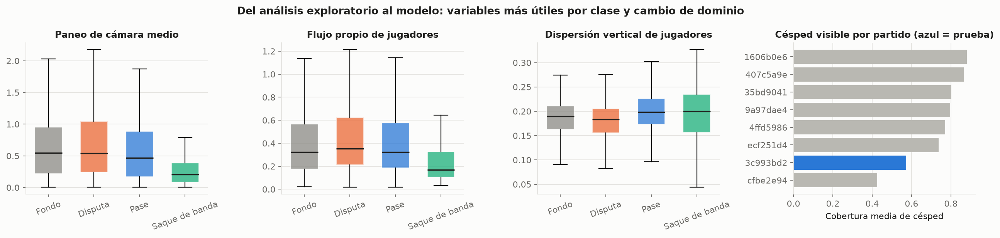

## 4.4 Ajuste de hiperparámetros

Todos los modelos se ajustaron solo con los 7 partidos de entrenamiento, mediante
validación cruzada agrupada por partido (`GroupKFold`, 5 pliegues) y F1 macro como métrica.
La Tabla 2 muestra la malla explorada y la combinación elegida.

*Tabla 2. Ajuste de hiperparámetros con validación cruzada por partido.*

| Modelo | Malla explorada | Elegido | F1 macro CV |
|---|---|---|---|
| Regresión logística | C ∈ {0.1, 1, 10}; class_weight ∈ {None, balanced} | C = 1, sin pesos | 0.286 ± 0.077 |
| Random Forest | árboles ∈ {300, 600}; profundidad ∈ {None, 10, 20}; hojas mín. ∈ {1, 2, 4} | 300 árboles, sin límite, hoja 1 | 0.324 ± 0.014 |
| XGBoost | árboles ∈ {300, 600}; profundidad ∈ {3, 5}; tasa ∈ {0.05, 0.1} | 600 árboles, profundidad 3, tasa 0.05 | 0.351 ± 0.054 |
| GRU | unidades ocultas ∈ {32, 64}; épocas ∈ {20, 40} | 32 unidades, 40 épocas | 0.316 ± 0.048 |

Para entender la sensibilidad de cada modelo se trazaron curvas de validación del
hiperparámetro principal (Figura 2). Los dos ensambles de árboles alcanzan F1 = 1.0 en
entrenamiento desde profundidad 8 o desde 200 árboles, mientras que la validación por
partido se estanca entre 0.30 y 0.35. En la regresión logística, C apenas cambia el
resultado (0.26–0.30). Es decir, **el límite no es la capacidad del modelo**: las variables
cambian de un partido a otro y más complejidad solo memoriza el entrenamiento. La
regularización de XGBoost (tasa 0.05 y árboles poco profundos) es lo que le da la mejor
validación.

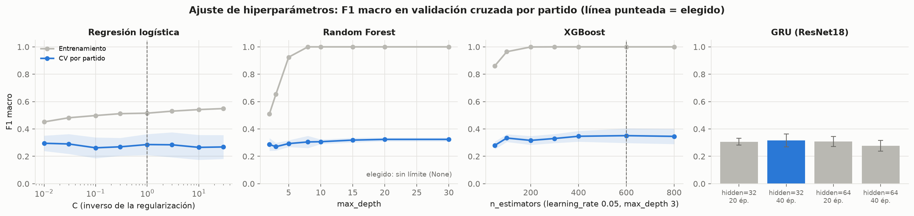

## 4.5 Comparación de los algoritmos

La evaluación final se hizo **una sola vez** sobre el partido de prueba `3c993bd2`, que no
intervino en ningún ajuste (`src/evaluate.py`). La Tabla 3 reúne las métricas; los tiempos
se midieron en un Apple M4 Pro y excluyen la extracción de variables, que cuesta entre 0.4
y 2 s por ventana y domina el tiempo total.

*Tabla 3. Métricas en el partido de prueba (en negrita, el mejor valor de cada columna).*

| Modelo | F1 macro | Exactitud | Exact. balanceada | Precisión macro | AP macro | F1 macro CV | Ajuste | Inferencia por subclip |
|---|---|---|---|---|---|---|---|---|
| Regresión logística | 0.289 | 0.293 | 0.302 | 0.316 | 0.292 | 0.286 | ~0.01 s | ~0.5 µs |
| Random Forest | 0.304 | **0.367** | **0.377** | **0.494** | **0.368** | 0.324 | ~0.2 s | ~70 µs |
| **XGBoost** | **0.347** | 0.362 | 0.372 | 0.355 | 0.359 | **0.351** | ~0.9 s | ~7 µs |
| GRU (ResNet18) | 0.114 | 0.180 | 0.247 | 0.291 | 0.279 | 0.316 | ~1.2 s | ~6 µs |

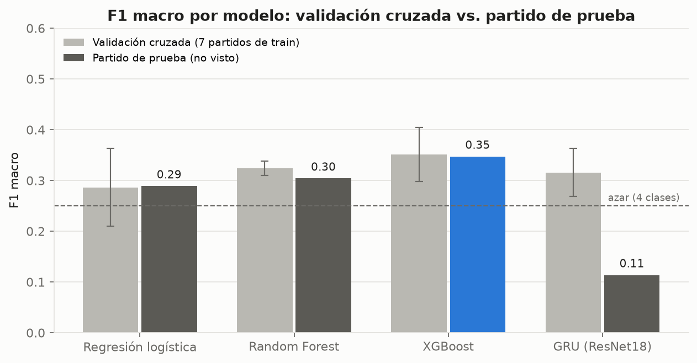

**XGBoost es el mejor modelo** por F1 macro (0.347) y el único que mantiene en el partido
nuevo casi el mismo desempeño que en validación cruzada (0.351), lo que indica que su
estimación de ajuste era honesta. El Random Forest tiene mejor exactitud y precisión, pero
porque se inclina hacia la clase fondo: la predice en el 70 % de los casos y casi nunca
predice disputa. La regresión logística, lineal, queda apenas sobre el azar (0.25).

La **GRU no generaliza**: obtuvo 0.316 en validación cruzada pero 0.114 en prueba, porque
predice saque de banda en 322 de los 362 subclips (Figura 5). Sus *embeddings* de ResNet18
describen apariencia general (colores, encuadre, público) y el partido de prueba tiene una
apariencia distinta; con solo 400 secuencias de entrenamiento la red no aprende a separar
la acción de la apariencia del partido. Como advierte el marco teórico, la comparación es
entre sistemas completos: la caída no prueba que una arquitectura recurrente sea peor, sino
que estos *embeddings* congelados no transfieren.

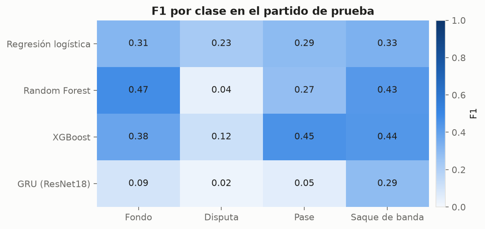

El desempeño por clase (Figura 4) confirma lo que anticipaba el análisis exploratorio. En
XGBoost, el **pase** (F1 0.45) y el **saque de banda** (0.44) son las clases mejor
reconocidas: el saque por ser la acción más quieta y el pase por la combinación de flujo y
dispersión de jugadores. La **disputa** es casi invisible para todos los modelos (F1 entre
0.02 y 0.23): la matriz de confusión (Figura 5) muestra que XGBoost la confunde con fondo en
el 59 % de los casos y el Random Forest en el 79 %. En 1.6 s, una disputa no tiene un patrón
de movimiento distinto al del juego sin acción.

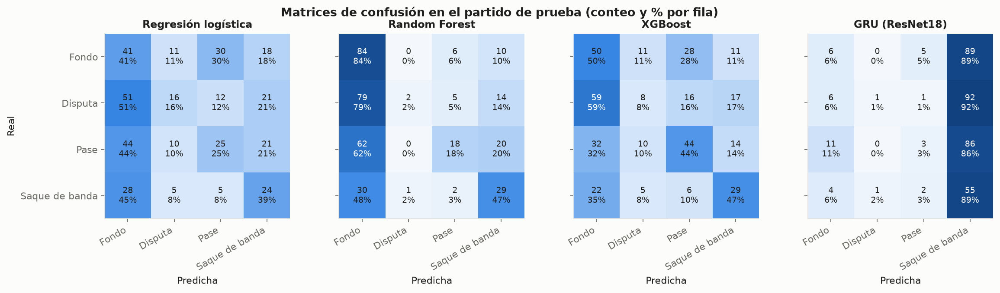

Las curvas de precisión-recall (Figura 6) son más informativas que la exactitud cuando
importa una clase concreta (Saito y Rehmsmeier, 2015). Para el pase, XGBoost alcanza una
precisión cercana a 0.9 en el 10 % de recall: cuando el modelo está muy seguro, casi
siempre acierta. Su precisión promedio (AP 0.48) casi duplica la prevalencia (0.28), y la del
saque de banda (0.37) duplica la suya (0.17); en cambio, fondo y disputa quedan apenas sobre
el azar. El modelo sirve para **encontrar los pases más claros**, no para detectarlos todos.

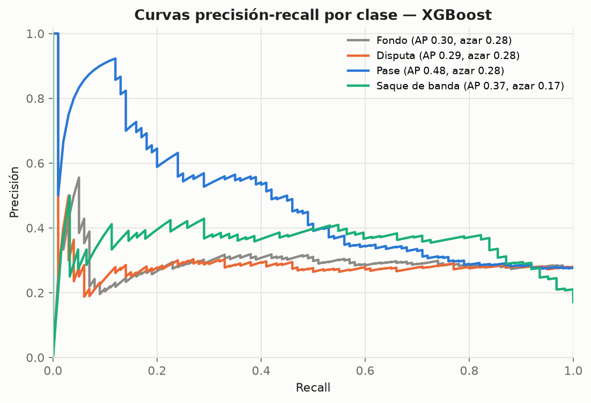

La importancia por permutación (Breiman, 2001), medida como la caída del F1 macro al
barajar cada variable en el partido de prueba, indica que XGBoost se apoya sobre todo en el
**flujo propio de jugadores** (`player_flow_mean`, `player_flow_min`, `player_flow_p90_max`),
la **dispersión de jugadores** detectados por YOLO y el **paneo de cámara** (Figura 7). Son
justamente las variables que el análisis exploratorio señaló como diferentes entre clases y
las que se diseñaron para separar el movimiento de la cámara del de los jugadores. Las
variables de color e iluminación, que más cambian entre partidos, aportan poco.

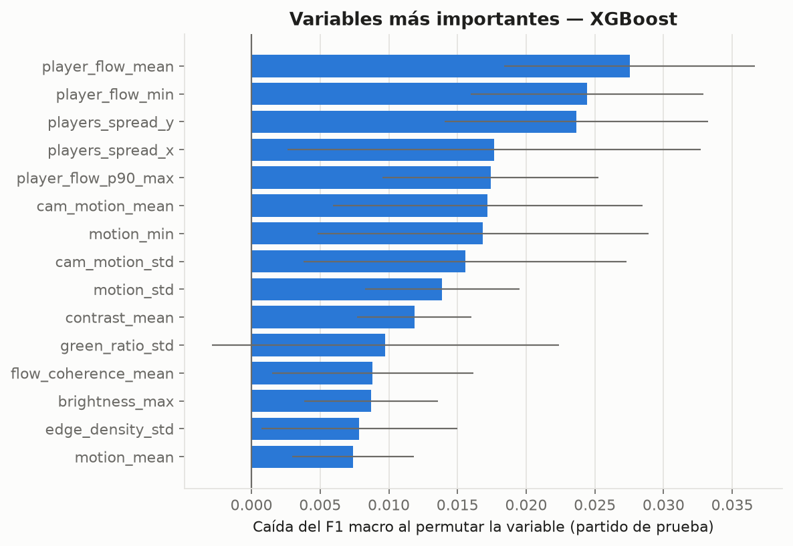

En costo computacional (Figura 8), los cuatro modelos clasifican un subclip en
microsegundos y se ajustan en menos de 2 s una vez elegidos los hiperparámetros; el costo
real está en la extracción de variables (flujo óptico, YOLO y ResNet18), común a todos. Por
eso el criterio de selección es el desempeño, no el tiempo.

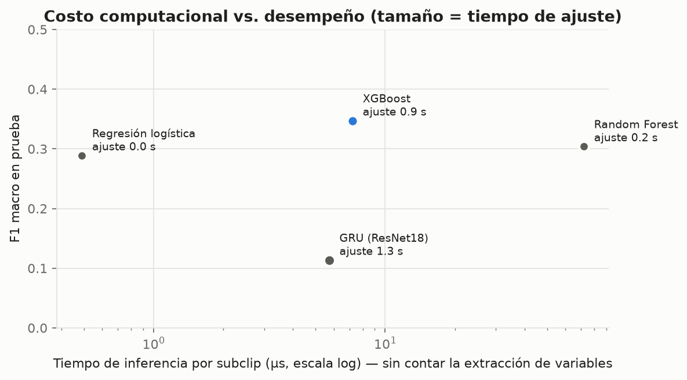

**Modelo seleccionado.** Se elige **XGBoost** como modelo principal: mejor F1 macro, mejor
F1 en pase (la clase de interés del reto) y la estimación de validación más estable. La
aplicación muestra además los otros tres modelos y su promedio para que el usuario compare
sus respuestas.

## 4.6 Aplicación

Se construyó una aplicación web con **Streamlit** (`app/app.py`), elegido porque permite
escribir la interfaz en el mismo Python que el resto del proyecto y reutilizar directamente
el preprocesamiento y los modelos. Las gráficas interactivas usan **Plotly** (zoom,
información al pasar el cursor, leyendas que se pueden activar y desactivar). Se ejecuta con
`streamlit run app/app.py` y tiene cuatro páginas:

1. **Resumen.** Cuenta la historia del proyecto en cinco pasos (datos, preprocesamiento,
   hallazgos del análisis exploratorio, modelos y resultado) junto a las gráficas que
   respaldan cada hallazgo.
2. **Explorar datos.** Las 762 ventanas tras la limpieza con las 48 variables de los
   modelos: filtros por conjunto, clase y partido; distribución de una variable por clase
   (caja, histograma o violín), dispersión entre dos variables, comparación por partido,
   matriz de correlación, tabla descargable y diccionario de variables.
3. **Clasificar video.** El usuario sube un video o elige uno de los cuatro ejemplos del
   partido de prueba, y decide si usar **todos los modelos o solo algunos**. Puede clasificar
   el momento del evento, un segundo concreto o **recorrer todo el video** con una ventana
   deslizante, que produce una línea de tiempo de probabilidades por clase. El recorte, el
   muestreo de cuadros y la extracción de variables ocurren sin intervención del usuario
   (`src/inference.py`). Se comprobó que la aplicación reproduce el entrenamiento: en los
   cuatro ejemplos las 16 predicciones (4 modelos × 4 videos) coinciden con las de la
   evaluación, y en tres de ellos todas las variables difieren menos de 0.3 % de las
   calculadas para entrenar.
4. **Rendimiento.** Métricas en el partido de prueba con gráficas interactivas: comparación
   de F1, métricas por clase, matriz de confusión (con o sin normalizar), curvas de
   precisión-recall, importancia de variables, curvas de ajuste y costo frente a desempeño.
   Un interruptor permite **ocultar toda esta información** y un selector elige qué modelos
   comparar.

Los colores siguen la teoría del color vista en clase. Cada clase tiene un color fijo en
todas las gráficas de la aplicación y del informe: pase azul, disputa naranja y saque de
banda verde azulado. Los tres se validaron para que se distingan entre sí con los tres tipos
de daltonismo. El fondo, que significa "sin acción", va en gris neutro. Los modelos no tienen
color propio: se identifican por nombre y solo el mejor se resalta en azul, para no competir
con los colores de clase. Las magnitudes (matrices de confusión, F1 por clase) usan una
escala secuencial de un solo tono, de claro a oscuro, y las correlaciones una escala
divergente rojo–azul con gris en el cero.

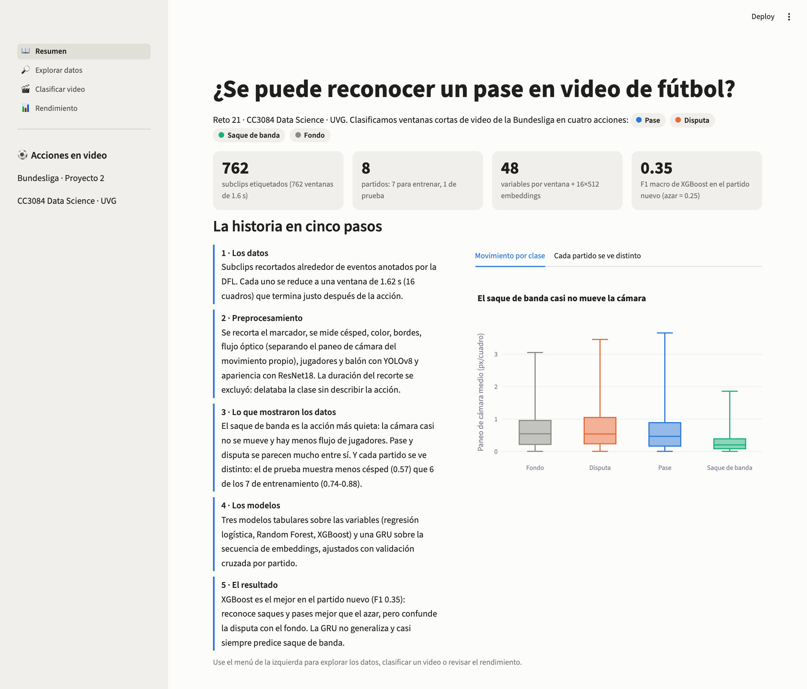

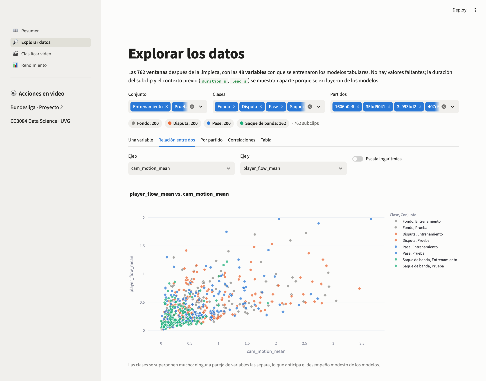

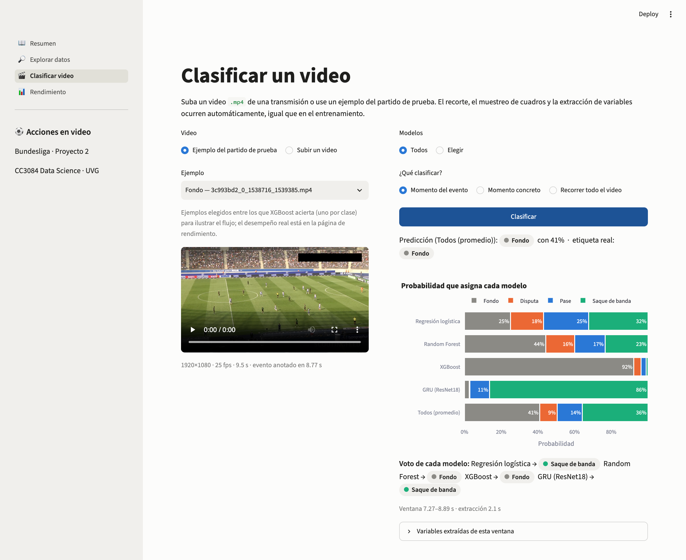

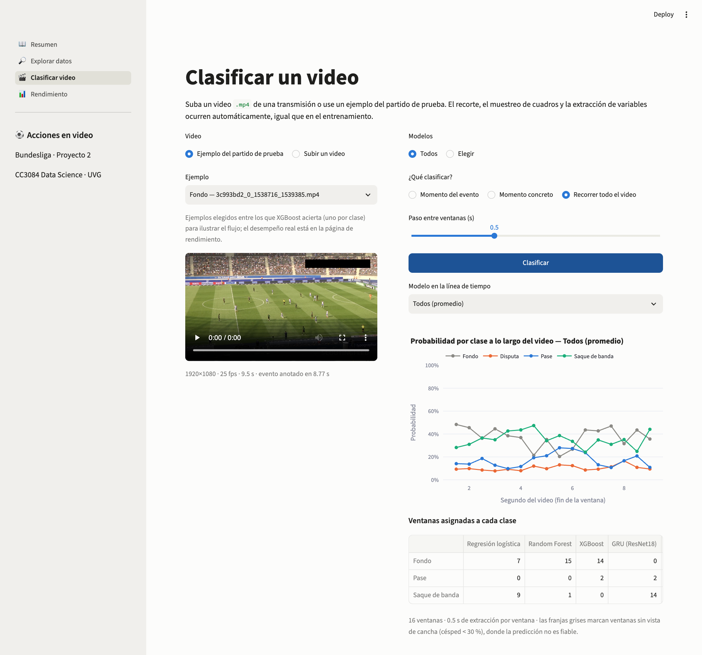

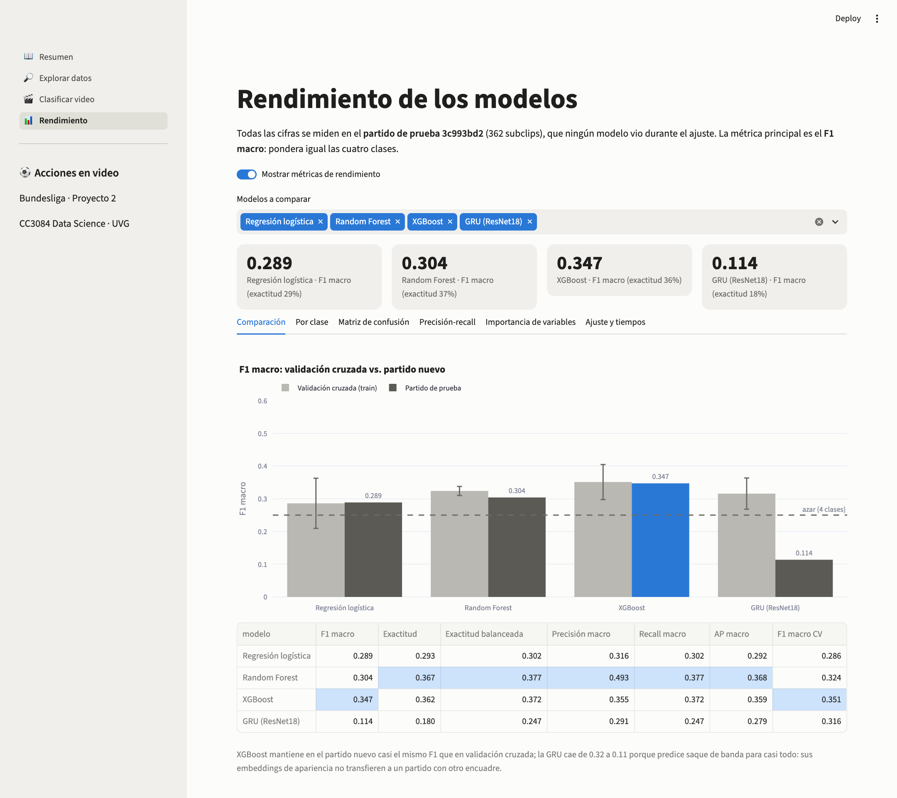

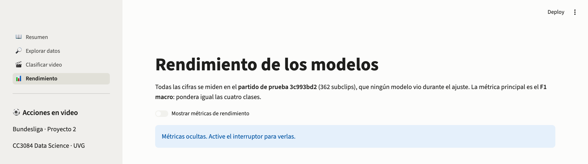
